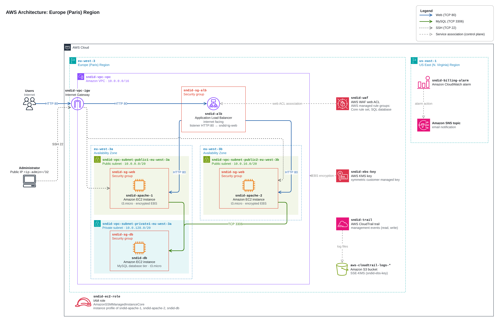

# AWS Reference Architecture

> Cloud-native replication of the local defense-in-depth architecture on AWS
> (region `eu-west-3`, Paris). This document records the target design, the architecture
> decisions behind each deviation from the local build, the cost model, and the teardown
> runbook. Deployment narrative and validation evidence: [Phase 07](../docs/phase-07-aws-deployment.md).

---

## Table of Contents

- [Scope](#scope)
- [Architecture Overview](#architecture-overview)
- [Service Mapping — Local to AWS](#service-mapping--local-to-aws)
- [Network Design](#network-design)
- [Deviations from the Specification](#deviations-from-the-specification)
- [Architecture Decision Records](#architecture-decision-records)
  - [ADR-001 — ALB replaces HAProxy](#adr-001--application-load-balancer-replaces-haproxy)
  - [ADR-002 — CloudTrail replaces ELK](#adr-002--cloudtrail-replaces-the-elk-stack-for-cloud-supervision)
  - [ADR-003 — No NAT Gateway](#adr-003--no-nat-gateway)
  - [ADR-004 — Security Groups as the only network filter](#adr-004--security-groups-as-the-only-network-filter)
  - [ADR-005 — One customer-managed key for EBS and CloudTrail](#adr-005--one-customer-managed-key-for-ebs-and-cloudtrail)
- [Cost Model](#cost-model)
- [Teardown Runbook](#teardown-runbook)

---

## Scope

The deployment reproduces the **web and data tiers** of the local architecture and the
security controls that protect them, using managed AWS services wherever a managed
equivalent exists. It is a time-boxed validation environment: built, tested, evidenced,
then fully destroyed.

| In scope | Out of scope |
|---|---|
| Network isolation (VPC, public/private subnets, 2 AZs) | Clients zone (no user workstation on AWS) |
| Stateful filtering (Security Groups) | HTTPS listener (requires ACM certificate and domain) |
| Load balancing with health checks (ALB) | Host-level log collection (CloudWatch agent) |
| Application-layer protection (AWS WAF) | Network deny logging (VPC Flow Logs) |
| Encryption at rest (KMS customer-managed key) | Infrastructure as Code (Terraform — roadmap) |
| Least-privilege instance identity (IAM role) | |
| API audit trail (CloudTrail) | |

---

## Architecture Overview

All resources carry the `sndid-` prefix so the complete footprint can be filtered and
verified during teardown.

---

## Service Mapping — Local to AWS

| Local component | AWS equivalent | Relationship |
|---|---|---|
| VMware VMnets (VMnet10–13) | VPC `10.0.0.0/16` + subnets | Layer 2/3 isolation |
| Router-firewall + `firewall.sh` | Security Groups (chained) | Stateful filtering — see [security-groups.md](security-groups.md) |
| HAProxy | Application Load Balancer | Managed L7 load balancing — ADR-001 |
| — | AWS WAF | Added control — no local equivalent |
| Apache-1 / Apache-2 VMs | EC2 `sndid-apache-1` / `sndid-apache-2` | Same role, one per AZ |
| MySQL VM | EC2 `sndid-db` (private subnet) | Same role — ADR-003 consequences apply |
| ELK stack | CloudTrail | Partial equivalent — ADR-002 |
| Unencrypted VM disks | EBS encrypted with KMS CMK | Closes a high-severity local limitation |
| Local `root` / sudo | IAM instance role | Least privilege for AWS API access |

---

## Network Design

| Subnet | CIDR | AZ | Route to Internet | Hosts |
|---|---|---|---|---|
| `sndid-vpc-subnet-public1-eu-west-3a` | 10.0.0.0/20 | eu-west-3a | Internet Gateway | ALB node, `sndid-apache-1` |
| `sndid-vpc-subnet-public2-eu-west-3b` | 10.0.16.0/20 | eu-west-3b | Internet Gateway | ALB node, `sndid-apache-2` |
| `sndid-vpc-subnet-private1-eu-west-3a` | 10.0.128.0/20 | eu-west-3a | None | `sndid-db` |
| `sndid-vpc-subnet-private2-eu-west-3b` | 10.0.144.0/20 | eu-west-3b | None | None (created by the wizard, unused) |

Two Availability Zones are mandatory: an Application Load Balancer cannot be created with
fewer than two subnets in distinct AZs. Private route tables contain only the local VPC
route — by design, no private subnet routes to the Internet.

---

## Deviations from the Specification

| Specification (CDC) | Deployed | Reason |
|---|---|---|
| HAProxy reproduced on EC2 | Not deployed — ALB | ADR-001 |
| ELK reproduced on EC2 | Not deployed — CloudTrail | ADR-002; Elasticsearch requires ≥ 4 GB RAM, a t3.micro has 1 GB |
| Ubuntu Server 22.04 LTS | Ubuntu Server 24.04 LTS | In the console Quick Start list, 22.04 appeared only as a SQL Server bundle that t3.micro does not support; 24.04 is from the same distribution family and Free Tier eligible |
| ALB distributing HTTP and HTTPS | HTTP:80 listener only | An HTTPS listener requires an ACM certificate bound to a domain name, out of scope |
| WAF Core Rule Set against SQLi, XSS and brute force | Core rule set + SQL database rule groups, no rate-based rule | The managed rule groups match request content; brute-force mitigation needs a rate-based rule, not configured |
| Health check every 4 s | Every 5 s | 5 s is the ALB minimum interval — detection after 2 failures is 10 s instead of 8 s |
| SSH key-only, Ed25519 (BF-04) | EC2 key pair of type RSA | Console default; Ed25519 key pairs are supported on Linux instances and would align with BF-04 |
| MySQL user restricted to DMZ range | Host `'%'` + Security Group | Restriction delegated to `sndid-sg-db`; a CIDR host value such as `'10.0.0.0/19'`, which covers both public subnets, would add it back in MySQL |

---

## Architecture Decision Records

### ADR-001 — Application Load Balancer replaces HAProxy

**Status:** Accepted · **Date:** 2026-09-21

**Context.** Locally, HAProxy is the single public entry point and a documented single point
of failure. The specification requires AWS WAF, which attaches only to managed resources
(ALB, CloudFront, API Gateway) — not to a process running on an instance.

| Option | Complexity | Cost | Availability | WAF attachment |
|---|---|---|---|---|
| HAProxy on EC2 behind nothing | Medium — manual config, patching | One instance | Single instance = SPOF | Not possible |
| HAProxy on EC2 behind an ALB | High — two layers | ALB + instance | ALB HA, HAProxy SPOF remains | On the ALB only |
| **ALB alone** | **Low — managed** | **≈ $0.026/h + LCU** | **Multi-AZ by construction** | **Native** |

**Decision.** Use the ALB as the only load balancing layer, with a target group mirroring
the HAProxy backend: HTTP `GET /`, healthy threshold 3, unhealthy threshold 2.

**Consequences.**
- The load balancing SPOF identified in the local architecture disappears.
- Health-check granularity is coarser: 5 s minimum interval versus 4 s in HAProxy.
- Distribution is round-robin **per ALB node**: with at least one node per AZ and DNS
  spreading clients across nodes, short request sequences do not alternate strictly between
  targets (observed in validation).
- Fine-grained HAProxy features — custom 503 page, configuration under version control —
  move to ALB fixed-response rules and would require IaC to stay versioned.

### ADR-002 — CloudTrail replaces the ELK stack for cloud supervision

**Status:** Accepted with a documented gap · **Date:** 2026-09-21

**Context.** The specification maps "rsyslog / ELK" to CloudTrail. ELK on EC2 is not viable
within Free Tier sizing (Elasticsearch needs at least 4 GB of RAM).

| Option | Covers | Cost | Operational load |
|---|---|---|---|
| ELK on EC2 (t3.large or larger) | Host and application logs | High — always-on instance | Full stack to operate |
| **CloudTrail** | **AWS API calls (control plane)** | **First trail free** | **None** |
| CloudWatch agent + CloudWatch Logs | Host syslog, application logs | Per GB ingested | Agent per instance |
| VPC Flow Logs | Accepted and rejected network flows | Per GB ingested | None |

**Decision.** Enable CloudTrail for management events, with log files encrypted by the
project CMK and integrity validation enabled.

**Consequences.**
- Every infrastructure change is attributable and timestamped (who created, modified or
  deleted which resource). This audit trail outlives the resources themselves — the event
  history remains queryable for 90 days after teardown.
- **CloudTrail is not a syslog equivalent.** It records the control plane, not what happens
  inside instances or on the network. The local `[FW-BLOCK]` signal maps to VPC Flow Logs
  `REJECT` records; host logs map to the CloudWatch agent. Neither was enabled. Full parity
  with the local SIEM would combine both, with Amazon GuardDuty for detection.

### ADR-003 — No NAT Gateway

**Status:** Accepted — revisit · **Date:** 2026-09-21

**Context.** A NAT Gateway gives private subnets outbound Internet access. It is the most
expensive network component of a small deployment and was excluded to stay within budget.

| Option | Private-tier egress | Approximate cost | Notes |
|---|---|---|---|
| **No NAT Gateway** | **None** | **$0** | Data tier fully sealed |
| NAT Gateway, permanent | Full | ≈ $0.05/h + data processing | ≈ $35+/month |
| NAT Gateway during provisioning only | Temporary | Cents | Delete once packages are installed |
| VPC interface endpoints (SSM) | AWS APIs only | Hourly per endpoint per AZ | Enables Session Manager, not apt |
| Pre-built AMI with MySQL | None needed | Snapshot storage | Best long-term option, pairs with IaC |

**Decision.** No NAT Gateway.

**Consequences.**
- The data tier has no route outside the VPC — the strongest possible isolation.
- **Discovered after deployment:** the private instance cannot reach the Ubuntu package
  archive, so MySQL installation through user data cannot complete, and the SSM agent
  cannot register (no Session Manager access). CloudTrail shows SSM heartbeats
  (`UpdateInstanceInformation`) from both web instances and none from `sndid-db`. The data
  tier's network isolation was validated; the MySQL service itself was not.
- **Revisit:** for any redeployment, provision the data tier through a temporary NAT
  Gateway or a pre-built AMI.

### ADR-004 — Security Groups as the only network filter

**Status:** Accepted · **Date:** 2026-09-21

**Context.** Locally, a single router enforces every inter-zone flow. On AWS, filtering can
happen at the subnet (Network ACLs), the interface (Security Groups), or the host.

| Option | Granularity | Deny rules | Logging | Maintenance |
|---|---|---|---|---|
| **Security Groups, SG-to-SG references** | **Per interface, by identity** | **Implicit only** | **None (needs Flow Logs)** | **Low** |
| Network ACLs in addition | Per subnet, by CIDR | Explicit, ordered | None | Stateless — return ports must be opened |
| Host firewall (iptables/ufw) in addition | Per host | Explicit | Local logs | Duplicated policy per instance |

**Decision.** A chain of three Security Groups referencing each other, no NACL customization,
no host firewall. Full rule set: [security-groups.md](security-groups.md).

**Consequences.**
- Rules follow resource identity, not IP addresses — robust to ALB node and instance IP changes.
- Denied traffic is invisible unless VPC Flow Logs are enabled.
- A single misconfigured Security Group is not backed by a second filtering layer; NACLs
  would restore defense in depth at the subnet boundary.

### ADR-005 — One customer-managed key for EBS and CloudTrail

**Status:** Accepted · **Date:** 2026-09-25

**Context.** The specification requires customer-managed KMS encryption for EBS. CloudTrail
log files can also be encrypted with SSE-KMS.

| Option | Cost | Separation of duties | Key policy effort |
|---|---|---|---|
| AWS-managed key `aws/ebs` | $0 | None — AWS-controlled | None |
| **One CMK for EBS and CloudTrail** | **$1/month** | **Low — shared blast radius** | **One added statement** |
| Dedicated CMK per data domain | $1/month per key | High | One policy per key |

**Decision.** A single CMK, `sndid-ebs-key`, encrypts both the EBS volumes and the CloudTrail
log files.

**Consequences.**
- CloudTrail is not authorized by a key's default policy. The trail could not be created
  until a statement granting `cloudtrail.amazonaws.com` the `kms:GenerateDataKey*` action
  was added to the key policy — see [kms-policy-cloudtrail-statement.json](kms-policy-cloudtrail-statement.json).
- **Hardening follow-up:** the added statement has no condition. AWS recommends scoping it
  to the trail with an `aws:SourceArn` condition
  (`arn:aws:cloudtrail:eu-west-3:<account-id>:trail/sndid-trail`) and a
  `kms:EncryptionContext:aws:cloudtrail:arn` condition, so the service principal can use the
  key only on behalf of this account's trails.
- Disabling or deleting the key makes both the volumes and the archived audit logs
  unreadable — the shared blast radius is the price of the single key.

---

## Cost Model

Approximate on-demand prices for `eu-west-3` at deployment time. Free Tier allowances depend
on account age and plan.

| Resource | Billing basis | Order of magnitude |
|---|---|---|
| Application Load Balancer | Per hour + LCU | ≈ $0.026/h → ≈ $19/month |
| AWS WAF | Per web ACL + per rule group + per million requests | $5 + $1 × 2 rule groups per month, prorated |
| KMS customer-managed key | Per key per month, prorated | $1/month — no charge once deletion is scheduled |
| EC2 t3.micro × 3 | Per hour | ≈ $0.012/h → ≈ $8.6/month each |
| Public IPv4 addresses | Per address per hour | $0.005/h × 4 (2 ALB nodes, 2 instances) → ≈ $15/month |
| CloudTrail | First management-events trail free | S3 storage for log files |
| NAT Gateway | — | Not deployed (ADR-003) |

Left running for a 730-hour month, the deployment would cost about **$68** at list prices,
EBS storage and LCU usage excluded, and about **$36** with the legacy Free Tier allowances
(750 hours a month each of t3.micro, Application Load Balancer and public IPv4). The
guardrail is a CloudWatch billing alarm (metric `EstimatedCharges`, region `us-east-1`,
threshold $5) with an SNS email notification, created before any other resource.

**Observed cost.** Deployed for about four days and then destroyed, the environment kept the
account's month-to-date estimated charges below the $5 alarm threshold: the alarm remained
in the `OK` state from its creation on 21 September through teardown.

---

## Teardown Runbook

Order matters: AWS refuses to delete a resource while another depends on it.

| Step | Action | Dependency resolved |
|---|---|---|
| 1 | WAF → web ACL → **Associated AWS resources** → disassociate the ALB, then delete `sndid-waf` | A web ACL cannot be deleted while associated |
| 2 | Delete load balancer `sndid-alb` | Releases the ALB network interfaces |
| 3 | Delete target group `sndid-tg-web` | Target group must not be referenced by a listener |
| 4 | Terminate the three instances | EBS root volumes are deleted with them |
| 5 | CloudTrail → stop logging, delete `sndid-trail` | — |
| 6 | S3 → empty, then delete **every** `aws-cloudtrail-logs-<account-id>-*` bucket | One bucket is created per trail creation attempt |
| 7 | Delete VPC `sndid-vpc-vpc` | Cascades to subnets, route tables, IGW, Security Groups |
| 8 | KMS → schedule deletion of `sndid-ebs-key` (7-day minimum) | Delete after the logs are no longer needed |
| 9 | EC2 → Key Pairs → delete `sndid-key` | Prevents reuse on future launches |
| 10 | Billing → Bills, next day | Confirms no residual charges |

**Verification.** In `eu-west-3`: EC2 instances, load balancers, target groups, volumes,
Elastic IPs and VPCs other than the default VPC must all be empty; S3 must contain no
`aws-cloudtrail-logs-` bucket unless deliberately retained. The billing alarm itself may be
kept — CloudWatch alarms within the free allowance cost nothing.
