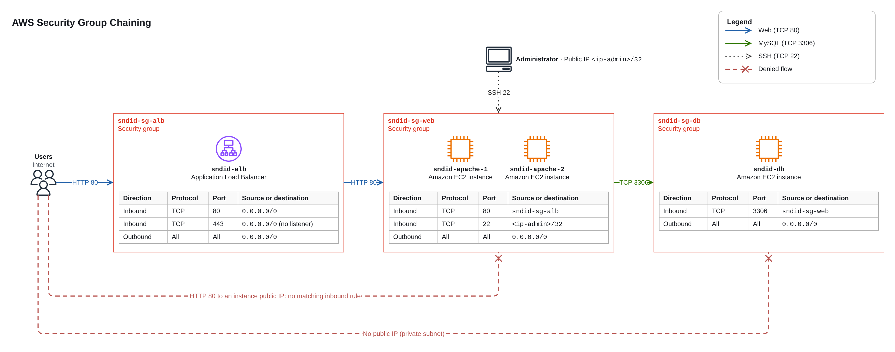

# AWS Security Groups — Inter-Zone Traffic Matrix

> Reference for the three Security Groups that reproduce, on AWS, the inter-zone traffic
> matrix enforced locally by [`scripts/firewall.sh`](../scripts/firewall.sh).
> Deployment narrative and evidence: [Phase 07](../docs/phase-07-aws-deployment.md).

---

## Design Principle — Identity-Based Chaining

The three groups form a strict chain: **Internet → ALB → web tier → database tier**.
Each tier admits traffic only from the Security Group of the tier directly in front of it.

Rules reference **another Security Group** instead of a CIDR block wherever the source is
an AWS resource. A rule such as "TCP 80 from `sndid-sg-alb`" matches any network interface
attached to that group, whatever its IP address. This is stronger than an IP-based rule:
the ALB's node addresses change as it scales, but its group membership does not.

The web tier rule also filters a flow that the local router never sees: HAProxy and the
Apache servers share the DMZ subnet (`172.16.40.0/24`), so their traffic does not cross
`firewall.sh`. On AWS, the web instances accept HTTP from the load balancer only.

---

## Rule Reference

### `sndid-sg-alb` — Application Load Balancer

| Direction | Protocol | Port | Source / Destination | Purpose |
|---|---|---|---|---|
| Inbound | TCP | 80 | `0.0.0.0/0` | Public HTTP entry point |
| Inbound | TCP | 443 | `0.0.0.0/0` | Parity with the local matrix — no HTTPS listener configured |
| Outbound | All | All | `0.0.0.0/0` | Forwarding to targets and health checks |

### `sndid-sg-web` — Apache web tier

| Direction | Protocol | Port | Source / Destination | Purpose |
|---|---|---|---|---|
| Inbound | TCP | 80 | `sndid-sg-alb` | Application traffic from the ALB only |
| Inbound | TCP | 22 | `<ip-admin>/32` | Administration from a single public address |
| Outbound | All | All | `0.0.0.0/0` | Package installation, SSM agent |

### `sndid-sg-db` — MySQL database tier

| Direction | Protocol | Port | Source / Destination | Purpose |
|---|---|---|---|---|
| Inbound | TCP | 3306 | `sndid-sg-web` | Database access from the web tier only |
| Outbound | All | All | `0.0.0.0/0` | Default — no route exists beyond the VPC (no NAT) |

---

## Mapping to the Local Firewall Policy

| Local flow | AWS control | Notes |
|---|---|---|
| Internet → HAProxy, TCP 80/443 (DNAT, then FORWARD) | `sndid-sg-alb` inbound 80/443 from `0.0.0.0/0` | ALB replaces HAProxy as the public entry point |
| HAProxy → Apache-1/2, TCP 80 (same DMZ subnet, not filtered by the router) | `sndid-sg-web` inbound 80 from `sndid-sg-alb` | Added control, by SG reference instead of IP |
| Apache → MySQL, TCP 3306 (FORWARD) | `sndid-sg-db` inbound 3306 from `sndid-sg-web` | Sole authorized flow into the data tier |
| SSH to the router bastion (INPUT), from the administrator workstation and the Clients zone only | `sndid-sg-web` inbound 22 from `<ip-admin>/32` | Same principle as the local bastion: one administration source. No SSH path to the data tier |
| DMZ, Clients and Servers zones → ELK, UDP 514 | Not replicated | Supervision moves to CloudTrail — see ADR-002 in [architecture-aws.md](architecture-aws.md) |
| Default `LOG [FW-BLOCK]` + `DROP` | Implicit deny | Security Groups deny silently and **log nothing** |

---

## Behavioral Differences: Security Groups vs iptables

| Property | iptables (`firewall.sh`) | Security Groups |
|---|---|---|
| Statefulness | Stateful via `conntrack` | Stateful — return traffic always allowed |
| Rule types | ACCEPT, DROP, LOG, REJECT | Allow only — anything unmatched is denied |
| Explicit deny | Yes | No (Network ACLs provide stateless deny if required) |
| Logging of denied traffic | `[FW-BLOCK]` prefix → kern.log → ELK | None — requires VPC Flow Logs (`REJECT` records) |
| Rule ordering | Evaluated top-down, first match wins | Unordered — union of all allow rules |
| Enforcement point | Central router (single choke point for inter-zone traffic) | Each network interface (distributed) |
| Source matching | IP / CIDR / interface | CIDR, prefix list, or another Security Group |

The two most significant consequences:

- **No deny logging.** The `[FW-BLOCK]` visibility built in Phases 03 and 05 has no
  automatic counterpart. VPC Flow Logs filtered on `action = REJECT` provide the equivalent
  signal; they were not enabled in this deployment.
- **No single choke point.** Enforcement is distributed across every interface. This removes
  the router as a single point of failure — the highest-severity limitation of the local
  architecture — but also removes the single place where all inter-zone traffic can be
  observed.

---

## Hardening Notes

- **Port 443 on `sndid-sg-alb`.** The rule exists for parity with the local matrix, but no
  HTTPS listener was configured (an HTTPS listener requires an ACM certificate bound to a
  domain name, out of scope). A port with no listener is not reachable, yet strict least
  privilege would remove the rule until a listener exists.
- **Outbound `0.0.0.0/0`.** All three groups keep the AWS default egress rule. Egress could
  be restricted per tier — for example `sndid-sg-alb` outbound TCP 80 to `sndid-sg-web`
  only — to limit the impact of a compromised instance.
- **Administrator address.** The SSH rule uses a single `/32`. A residential IP address
  can change; the rule must be updated, never widened to `0.0.0.0/0`. AWS Systems Manager
  Session Manager (enabled through the instance role) removes the need for an inbound SSH
  rule entirely, provided the instance has a path to the SSM endpoints.
