# Phase 07 — AWS Cloud Deployment

> Replication of the defense-in-depth architecture on AWS with native security primitives:
> isolated VPC across two Availability Zones, chained Security Groups, Application Load
> Balancer protected by AWS WAF, EBS encryption with a customer-managed KMS key,
> a least-privilege IAM instance role, and a CloudTrail audit trail. Implements security layer 6 of the
> defense-in-depth model. Gate 4 validation.

---

## Table of Contents

- [Objective](#objective)
- [Deployed Architecture](#deployed-architecture)
- [Implementation](#implementation)
- [Challenges and Resolutions](#challenges-and-resolutions)
- [Validation](#validation)
- [Known Limitations and Coverage Gaps](#known-limitations-and-coverage-gaps)
- [Teardown](#teardown)
- [Outcome](#outcome)

**Reference documents**

| Document | Content |
|---|---|
| [`aws/architecture-aws.md`](../aws/architecture-aws.md) | Service mapping, deviations, architecture decision records, cost model, teardown runbook |
| [`aws/security-groups.md`](../aws/security-groups.md) | Security Group rules and their mapping to `firewall.sh` |
| [`aws/user-data/`](../aws/user-data/) | EC2 bootstrap scripts |
| [`aws/kms-policy-cloudtrail-statement.json`](../aws/kms-policy-cloudtrail-statement.json) | Key policy statement added for CloudTrail |
| [`docs/architecture/07-aws-architecture.png`](architecture/07-aws-architecture.png), [`docs/architecture/08-aws-security-groups.png`](architecture/08-aws-security-groups.png) | AWS architecture and Security Group diagrams |

In the captures, the AWS account ID and the administrator's public IP address are masked
with grey boxes. Nothing else was altered.

---

## Objective

Demonstrate that the architectural choices validated locally in Phases 00–06 transfer to a
cloud-native environment, replacing each locally built control with its managed AWS
equivalent — and record precisely where the equivalence holds, where it improves on the
local build, and where it falls short.

The environment was time-boxed: deployed, validated, evidenced, then fully destroyed to
avoid charges outside the Free Tier.

---

## Deployed Architecture

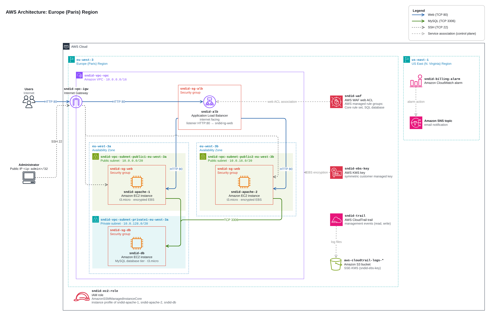

| Resource | Name | Key settings |
|---|---|---|
| Region | `eu-west-3` (Paris) | European region close to the project location |
| VPC | `sndid-vpc-vpc` | `10.0.0.0/16`, 2 AZs, 2 public + 2 private subnets, no NAT Gateway |
| Security Groups | `sndid-sg-alb`, `sndid-sg-web`, `sndid-sg-db` | Chained by SG reference |
| KMS key | `sndid-ebs-key` | Symmetric, customer-managed |
| IAM role | `sndid-ec2-role` | `AmazonSSMManagedInstanceCore` only, no access keys |
| EC2 | `sndid-apache-1`, `sndid-apache-2`, `sndid-db` | t3.micro, Ubuntu Server 24.04 LTS, encrypted EBS |
| Target group | `sndid-tg-web` | HTTP:80, `GET /`, interval 5 s, healthy 3, unhealthy 2 |
| Load balancer | `sndid-alb` | Internet-facing, both public subnets, listener HTTP:80 |
| WAF | `sndid-waf` | Regional, AWS managed Core rule set + SQL database rule group |
| CloudTrail | `sndid-trail` | Management events read/write, SSE-KMS, log file validation |

Deviations from the local architecture and the specification (HAProxy and ELK not
reproduced on EC2, Ubuntu 24.04, 5-second health-check interval, HTTP listener only, no WAF
rate-based rule) are justified in
[`aws/architecture-aws.md`](../aws/architecture-aws.md#deviations-from-the-specification).

---

## Implementation

### 1. Cost guardrail

A CloudWatch billing alarm, `sndid-billing-alarm`, was created **before any other resource**,
in region `us-east-1` where billing metrics are published. All resources carry the `sndid-`
prefix to make the full footprint filterable at teardown.

| Setting | Value |
|---|---|
| Metric | `AWS/Billing` · `EstimatedCharges` · USD |
| Condition | `EstimatedCharges > 5` for 1 datapoint within 6 hours |
| Statistic / period | Maximum / 6 hours |
| Action | SNS email notification |
| First evaluation | 2026-09-21 17:13 UTC — before the first project resource (IAM role created 18:23 UTC) |

The alarm's state history covers the whole lifecycle of the environment, from deployment
on 21 September through teardown and beyond. It never left the `OK` state: the account's
month-to-date estimated charges stayed below the $5 threshold for the entire period.

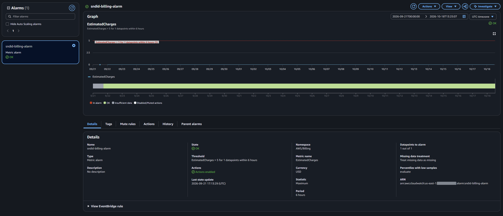

### 2. Network — VPC and subnets

The VPC creation wizard, run with the name prefix `sndid-vpc`, created `sndid-vpc-vpc`
(`10.0.0.0/16`) with one public and one private subnet in each of `eu-west-3a` and
`eu-west-3b`. Public subnets route to the Internet Gateway; private route tables contain
only the local route. No NAT Gateway was created
([ADR-003](../aws/architecture-aws.md#adr-003--no-nat-gateway)).

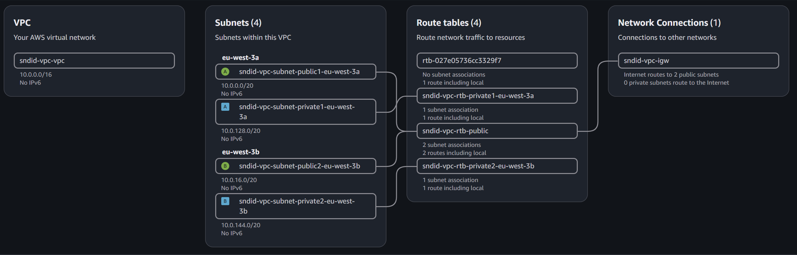

### 3. Stateful filtering — Security Groups

Three Security Groups reproduce the local inter-zone matrix. Each tier admits traffic only
from the Security Group of the tier in front of it. Full rule reference and mapping to
`firewall.sh`: [`aws/security-groups.md`](../aws/security-groups.md).

`sndid-sg-web` — HTTP from the ALB group only, SSH from a single administrator address:

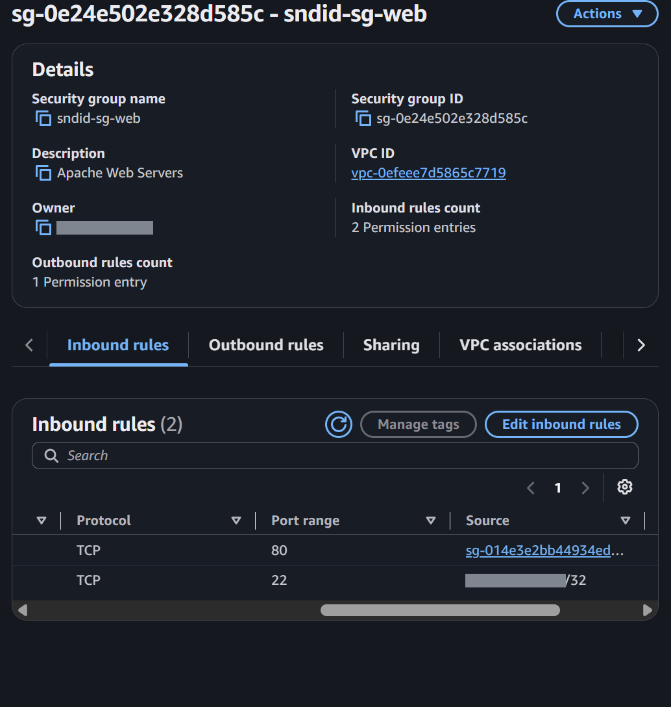

`sndid-sg-db` — MySQL from the web tier group only:

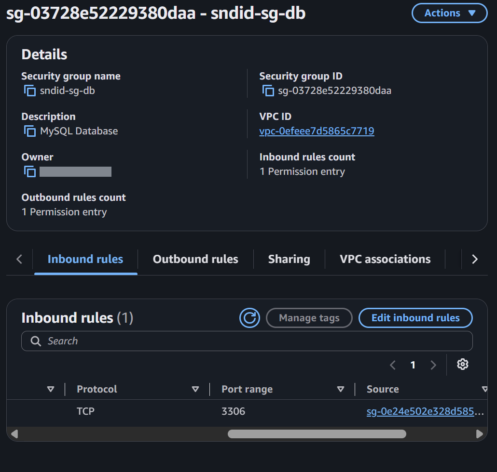

### 4. Encryption at rest — KMS customer-managed key

A symmetric customer-managed key, `sndid-ebs-key`, encrypts every EBS volume and the
CloudTrail log files ([ADR-005](../aws/architecture-aws.md#adr-005--one-customer-managed-key-for-ebs-and-cloudtrail)).
This closes the "data at rest" limitation of the local build, whose VM disks are unencrypted.

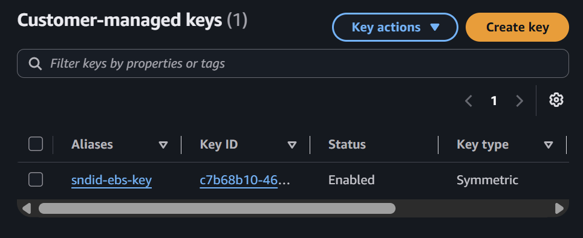

### 5. Identity — IAM instance role

`sndid-ec2-role` carries a single AWS managed policy, `AmazonSSMManagedInstanceCore`. Web
pages need no AWS API access, so the role grants nothing beyond what Systems Manager requires.
No IAM user and no access key were created. The console operations, however, were performed
with the account root user, as the CloudTrail event history shows
(see [Known Limitations](#known-limitations-and-coverage-gaps)).

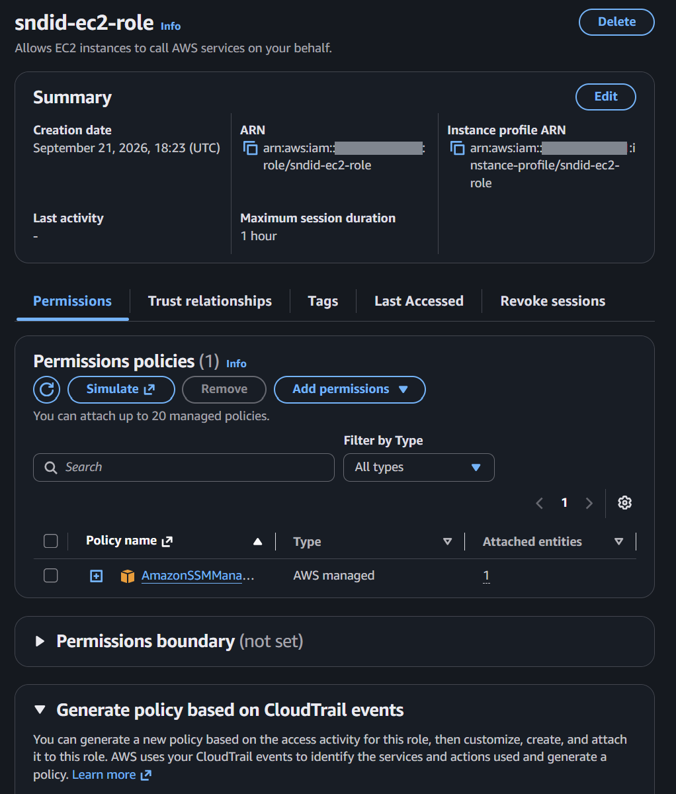

### 6. Compute — EC2 instances

Three t3.micro instances, each with its root EBS volume encrypted by `sndid-ebs-key` and the
`sndid-ec2-role` instance profile attached.

| Instance | Subnet | Public IP | Security Group | Bootstrap |
|---|---|---|---|---|
| `sndid-apache-1` | public, eu-west-3a | Yes | `sndid-sg-web` | [`apache.sh`](../aws/user-data/apache.sh), `NODE_NAME="Apache-1"` |
| `sndid-apache-2` | public, eu-west-3b | Yes | `sndid-sg-web` | [`apache.sh`](../aws/user-data/apache.sh), `NODE_NAME="Apache-2"` |
| `sndid-db` | private, eu-west-3a | No | `sndid-sg-db` | [`mysql.sh`](../aws/user-data/mysql.sh) — see limitations |

The Apache bootstrap reapplies the version-disclosure hardening validated locally
(`ServerTokens Prod`, `ServerSignature Off`).

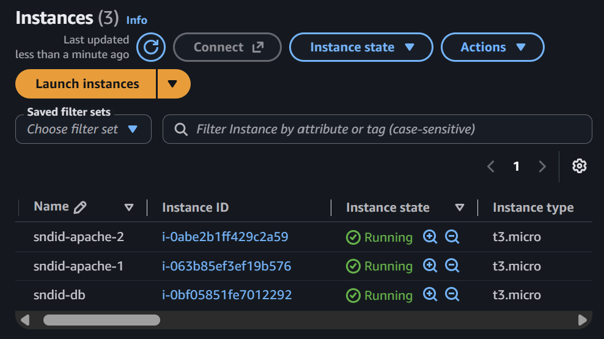

### 7. Load balancing — ALB and target group

Target group `sndid-tg-web` mirrors the local HAProxy backend — `GET /`, 2 failures to mark
a target unhealthy, 3 successes to restore it — with a 5-second interval, the ALB minimum.
Both web instances are registered on port 80. The internet-facing ALB `sndid-alb` spans both
public subnets with a single HTTP:80 listener forwarding to the target group
([ADR-001](../aws/architecture-aws.md#adr-001--application-load-balancer-replaces-haproxy)).

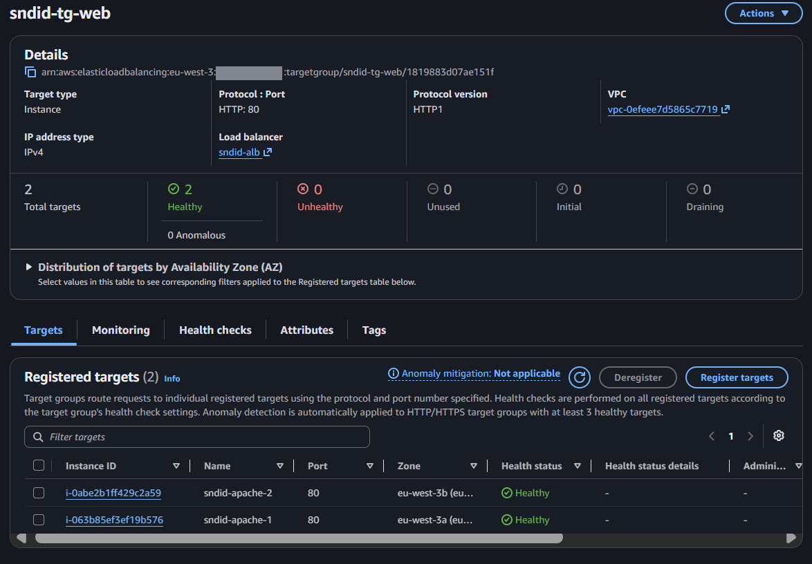

### 8. Application-layer protection — AWS WAF

Regional web ACL `sndid-waf`, associated with `sndid-alb`, with two AWS managed rule groups:
the **Core rule set** (common web exploits, including some of the OWASP Top 10 risks) and
**SQL database** (SQL injection patterns). Default action: Allow. No rate-based rule was
configured.

The infrastructure was destroyed before the web ACL configuration was captured. The
CloudTrail event history (event source `wafv2.amazonaws.com`) records its removal on
25 September 2026: two `DeleteWebACL` calls, then `ListResourcesForWebACL`,
`DisassociateWebACL` and a last `DeleteWebACL`. The `DisassociateWebACL` call shows that the
web ACL was still associated with a resource at teardown. The event list does not name that
resource, and the creation and association events are not on the captured page.

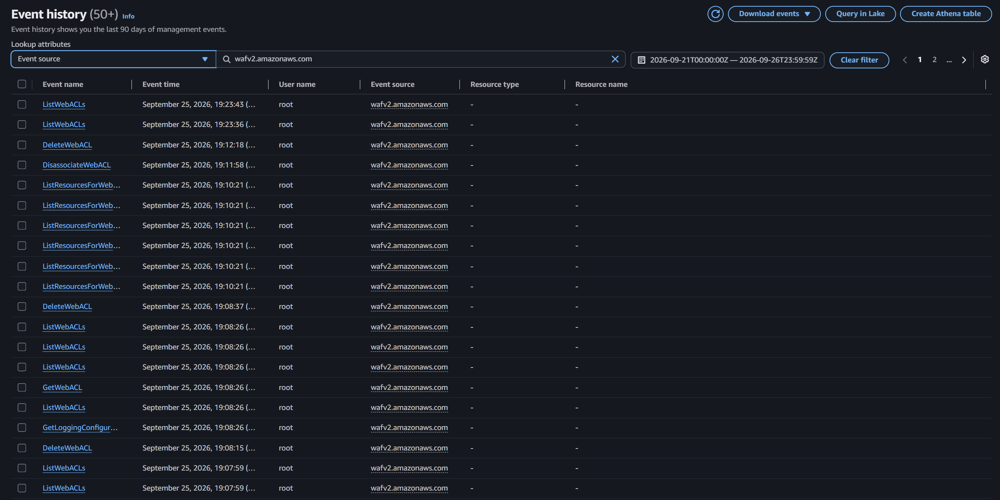

### 9. Audit — CloudTrail

Trail `sndid-trail` records management events (read and write) to an S3 bucket, with log
files encrypted by `sndid-ebs-key` (SSE-KMS) and log file integrity validation enabled.

---

## Challenges and Resolutions

**Wrong AMI — Ubuntu 22.04 bundled with SQL Server**

The first launch failed with `Microsoft SQL Server is not supported for the instance type
't3.micro'`. In the Quick Start AMI list, Ubuntu 22.04 appeared only as *Ubuntu Server 22.04
LTS (HVM) with SQL Server 2022 Standard*, a commercial image that AWS does not support on
t3.micro and that is not Free Tier eligible. Ubuntu Server 24.04 LTS, from the same
distribution family and Free Tier eligible, was selected instead and the deviation recorded.

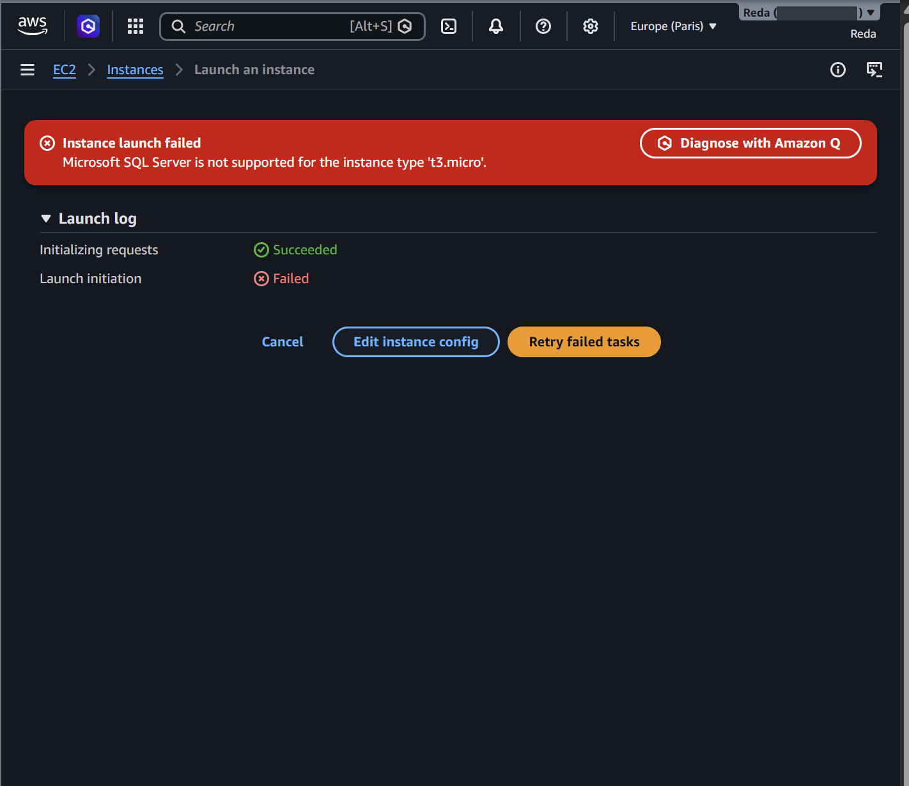

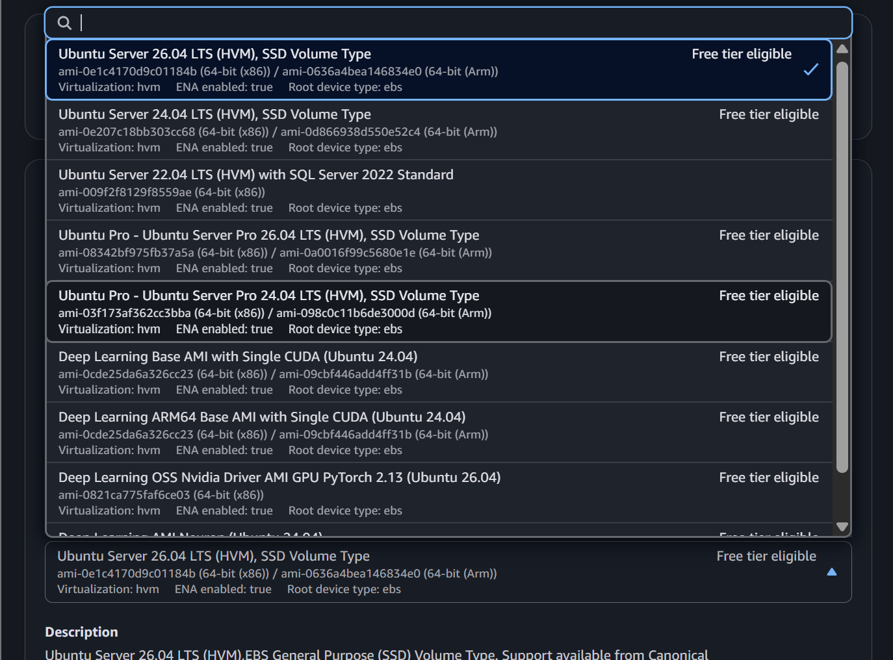

**CloudTrail rejected by the KMS key policy (`InsufficientEncryptionPolicyException`)**

Creating the trail with SSE-KMS failed: a customer-managed key's default policy authorizes
only the account's principals, not AWS services. CloudTrail could not generate data keys
with `sndid-ebs-key`. The key policy was extended with a statement granting the service
principal `cloudtrail.amazonaws.com` the `kms:GenerateDataKey*` action
([`kms-policy-cloudtrail-statement.json`](../aws/kms-policy-cloudtrail-statement.json)).
The CloudTrail event history records the sequence: several `CreateTrail` / `CreateBucket`
attempts, the `PutKeyPolicy` fix, then a successful `CreateTrail` followed by `StartLogging`.

**`nmap` unavailable in the test shell**

`nmap` was not installed in the shell used for testing, and `apt` is not available there.
The direct-access test was performed with `curl --connect-timeout 5` against each
instance's public IP. A connection timeout is conclusive here: the instance is running and
healthy behind the ALB, its public subnet routes to the Internet Gateway, the network ACLs
keep their default allow rules and no host firewall is configured, so the only component
able to discard the connection is the Security Group.

**Web ACL could not be deleted during teardown (`Unable to delete sndid-waf`)**

AWS refuses to delete a web ACL that is still associated with a resource. The ALB was
disassociated under the web ACL's *Associated AWS resources* tab, after which the deletion
succeeded. The error is incidentally evidence that the web ACL was effectively attached to
the ALB.

---

## Validation

All tests were run from outside the VPC, so the source address belongs to none of the
project's Security Groups.

| ID | Objective | Method | Expected | Observed | Status |
|---|---|---|---|---|---|
| T-13a | Application reachable through the ALB | `curl -I http://<alb-dns-name>` | HTTP 200 | `HTTP/1.1 200 OK`, `Server: Apache` (no version) | Pass |
| T-13b | Both targets serve traffic | 6 sequential `curl` | Responses from both nodes | Apache-2 ×4, Apache-1 ×2 | Pass |
| T-13c | Direct access to instances blocked | `curl --connect-timeout 5` on each public IP | Timeout | Timeout after 5002 ms, both instances | Pass |
| T-13d | Targets healthy | Target group console | 2 / 2 healthy | 2 healthy, 0 unhealthy | Pass |
| T-14a | EBS encrypted with the CMK | `aws ec2 describe-volumes` | 3 × `Encrypted = True`, CMK ARN | 3 × `True`, identical CMK ARN | Pass |
| T-14b | Encryption visible in console | EC2 → Volumes | Encrypted, `sndid-ebs-key` | Encrypted, KMS key ID `c7b68b10-46…`, the ID of `sndid-ebs-key` (evidence 04) | Pass |
| T-14c | Key and trail activity audited | CloudTrail event history | KMS and CloudTrail API calls recorded | `PutKeyPolicy`, `CreateTrail`, `StartLogging` recorded | Pass |
| G4-WAF | WAF attached to the ALB | CloudTrail event history | Web ACL associated with `sndid-alb` | `DisassociateWebACL` recorded at teardown (evidence 14): an association existed. The resource is not named in the list and `AssociateWebACL` is not on the captured page | Pass (indirect evidence) |

### T-13 — Access exclusively through the ALB

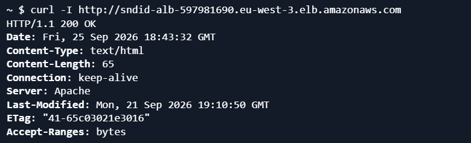

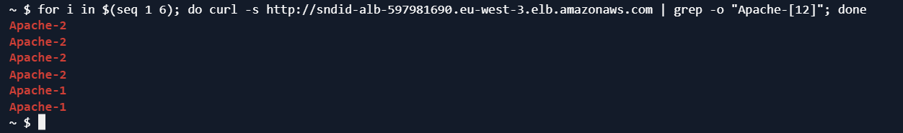

The sequence does not alternate strictly, unlike HAProxy in Phase 04. This is expected ALB
behavior rather than a defect: the load balancer has at least one node in each enabled
Availability Zone, each `curl` resolves the DNS name again and may reach a different node,
and each node applies round robin on its own. A larger sample, not run in this deployment,
would measure the actual distribution:

```bash
for i in $(seq 1 100); do curl -s http://<alb-dns-name> | grep -o "Apache-[12]"; done | sort | uniq -c
```

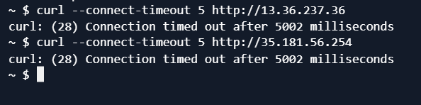

### T-14 — Encryption at rest with a customer-managed key

```bash
aws ec2 describe-volumes --region eu-west-3 --query 'Volumes[*].[VolumeId, Encrypted, KmsKeyId]' --output table
```

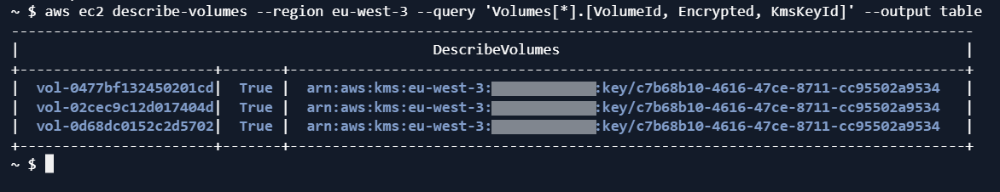

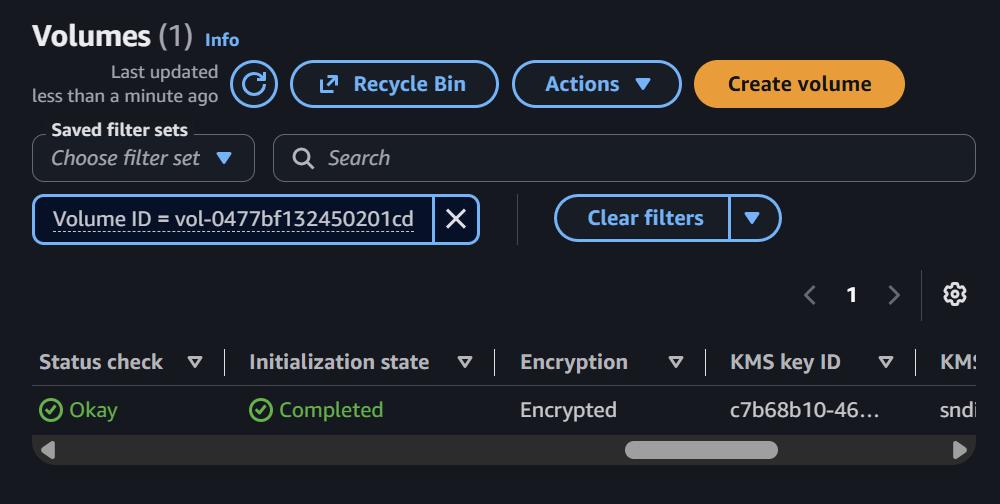

### Audit trail

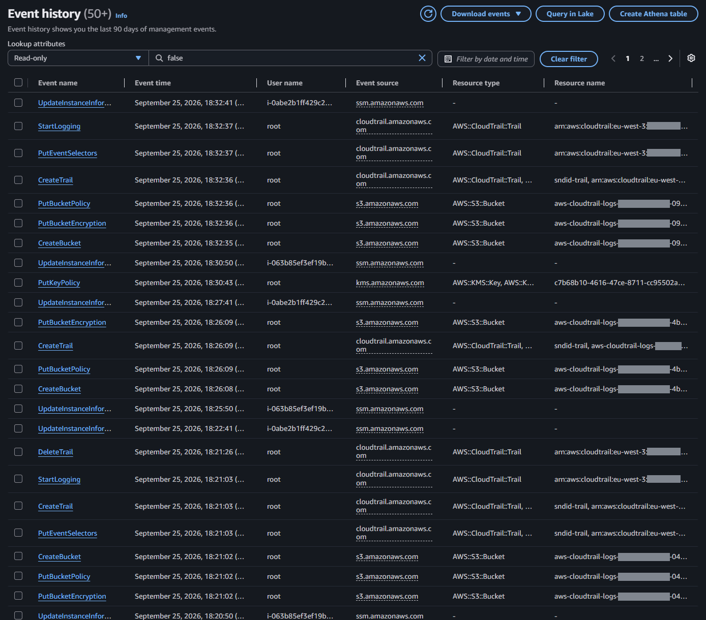

---

## Known Limitations and Coverage Gaps

| Area | Finding | Impact | Follow-up |
|---|---|---|---|
| Data tier service | The private subnet has no egress path (no NAT, by design). MySQL installation through user data cannot reach the package archive, and the SSM agent cannot register — CloudTrail shows SSM heartbeats from both web instances and none from `sndid-db`. | Network isolation of the data tier validated; MySQL service **not** verified on AWS | Temporary NAT Gateway during provisioning, or pre-built AMI ([ADR-003](../aws/architecture-aws.md#adr-003--no-nat-gateway)) |
| WAF efficacy | The web ACL was attached, but no malicious payload was sent through it | Rule effectiveness untested | On redeployment: `curl "http://<alb-dns-name>/?id=1'%20OR%20'1'='1"` → expect HTTP 403 |
| Brute-force protection | The managed rule groups inspect request content, not request rate, and no rate-based rule was configured | Request floods and credential brute force are not throttled at the ALB | Rate-based rule aggregated by source IP, with a stricter limit on any login path |
| Administrative identity | The CloudTrail event history attributes the console operations to the root user. AWS recommends using the root user only for the tasks that require it | Every console action ran with unrestricted account privileges | Administrative user in IAM Identity Center with MFA for daily work; root user with MFA, kept for root-only tasks |
| Failover | Target deregistration or failure was not exercised on AWS | ALB failover inferred from configuration, validated locally only (T-10) | Stop Apache on one target and observe the target group state |
| Deny visibility | Security Groups log nothing; VPC Flow Logs not enabled | No cloud equivalent of `[FW-BLOCK]` | VPC Flow Logs filtered on `REJECT` |
| Host logs | No CloudWatch agent | CloudTrail covers the control plane only ([ADR-002](../aws/architecture-aws.md#adr-002--cloudtrail-replaces-the-elk-stack-for-cloud-supervision)) | CloudWatch agent + GuardDuty |
| HTTPS | No HTTPS listener — requires an ACM certificate bound to a domain | Traffic between client and ALB unencrypted | ACM certificate + HTTPS listener + HTTP → HTTPS redirect |
| KMS statement scope | The CloudTrail statement has no condition | Service principal not restricted to this account's trail | Add `aws:SourceArn` and encryption-context conditions ([ADR-005](../aws/architecture-aws.md#adr-005--one-customer-managed-key-for-ebs-and-cloudtrail)) |

---

## Teardown

Once all evidence was captured, every resource was destroyed in dependency order: WAF
(after disassociation), ALB, target group, instances (EBS volumes deleted with them),
CloudTrail, VPC (cascading to subnets, route tables, Internet Gateway and Security Groups),
and KMS key deletion scheduled at the 7-day minimum. The complete runbook, including the
S3 buckets and key pair to remove, is in
[`aws/architecture-aws.md`](../aws/architecture-aws.md#teardown-runbook).

---

## Outcome

The defense-in-depth architecture is replicated on AWS and Gate 4 is formally validated:

- VPC isolated across two Availability Zones, data tier in a private subnet without Internet route
- Three chained Security Groups reproducing the local traffic matrix by resource identity
- HTTP 200 through the ALB; direct access to the instances refused (T-13)
- Both targets healthy and serving traffic
- All three EBS volumes encrypted with the customer-managed key `sndid-ebs-key` (T-14)
- Least-privilege instance role (`AmazonSSMManagedInstanceCore` only); no access key created
- AWS WAF with Core rule set and SQL database rule groups attached to the ALB
- CloudTrail audit trail encrypted with the CMK, integrity validation enabled
- Environment fully destroyed after validation

Compared with the local build, the cloud deployment removes two high-severity limitations —
the load balancer single point of failure and unencrypted data at rest — and adds an
application-layer control (WAF). It loses deny-traffic visibility and host-level log
collection, which require VPC Flow Logs and the CloudWatch agent to restore.

**Gate 4 status: PASSED**

**Next phase:** [Phase 08 — Validation and Red Team Scenarios](phase-08-validation.md)
